<!-- Profile README for github.com/UzairBaig991
     Search for "EDIT:" to find details you can still personalize. -->

<!-- ===== BANNER ===== -->

 

 

<a href="#about"><b>🏠 About</b></a> &nbsp;·&nbsp;
<a href="#tech"><b>⚡ Skills</b></a> &nbsp;·&nbsp;
<a href="#projects"><b>🚀 Projects</b></a> &nbsp;·&nbsp;
<a href="#more"><b>🗂️ More Work</b></a> &nbsp;·&nbsp;
<a href="#journey"><b>🛣️ Journey</b></a> &nbsp;·&nbsp;
<a href="#experience"><b>💼 Experience</b></a> &nbsp;·&nbsp;
<a href="#certificates"><b>📜 Certificates</b></a> &nbsp;·&nbsp;
<a href="#education"><b>🎓 Education</b></a> &nbsp;·&nbsp;
<a href="#contact"><b>📫 Contact</b></a>

> *"I turn ideas into clean, working software, and I'm growing into a designer who cares how it feels to use."*

Hi, I'm **Uzair Baig** from **Rawalpindi, Pakistan 🇵🇰**, a **BS Software Engineering** student at **Riphah International University** (Rawalpindi) with hands-on experience from **two internships** and a **Cisco C++ certification**. I build web apps, mobile apps, AI tools and system simulators, and my goal is to become a **UI/UX Designer** who can also write the code behind the design.

| 🎓 Studying | 💼 Internships | 📜 Certified | 📦 Projects | 🎯 Goal |
|:---:|:---:|:---:|:---:|:---:|
| **BS Software Engineering** | **2** (Arch Technologies, Syntecxhub) | **Cisco C++** | **50+ repos** | **UI/UX Designer** |

<table>
<tr>
<td>

| | |
|---|---|
| 🔭 **Recently built** | StockWise-AI · EcoSwap · RoyalLudo · PDFForge · AutoFlow |
| 🌱 **Learning** | UI/UX design, Figma, advanced web & mobile development |
| 🤝 **Open to** | Internships, collaborations, freelance projects |
| 💬 **Ask me about** | Web development, Android apps, C++, DSA, UI design |
| 📍 **Based in** | Rawalpindi, Pakistan (UTC+5) |
| ⚡ **Fun fact** | I've built everything from a Ludo game to an OS simulator |

</td>
</tr>
</table>

<!-- Remove any icon for tools you don't actually use. -->

**Languages** 

**Web & Mobile** 

**Backend & Databases** 

**Design & Tools** 

### 🧠 Core Computer Science

### 🗺️ Skills Map

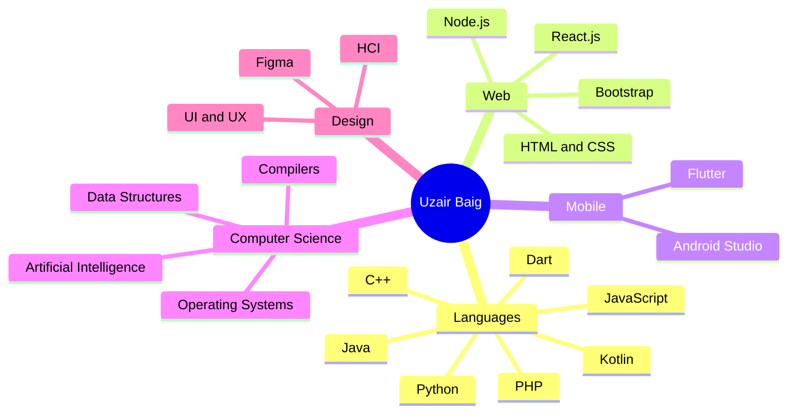

<a href="https://github.com/UzairBaig991/EcoSwap-MAD-Project">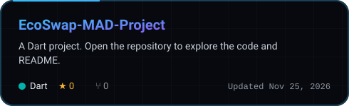</a>

<a href="https://github.com/UzairBaig991/PDFForge">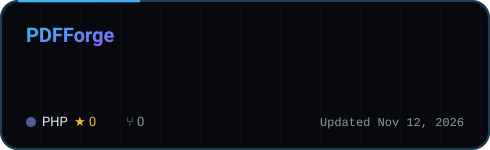</a>

<a href="https://github.com/UzairBaig991/Enterprise-Flow-ERP">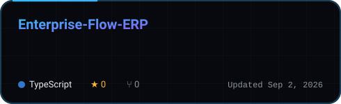</a>
<a href="https://github.com/UzairBaig991/OS-Simulator">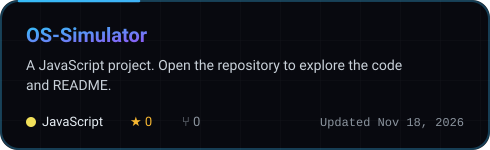</a>

<a href="https://github.com/UzairBaig991/AutoFlow">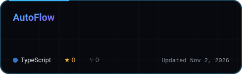</a>
<a href="https://github.com/UzairBaig991/Movie-Recommendation-System">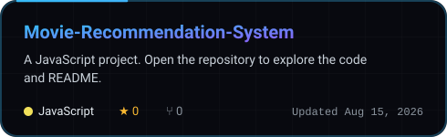</a>

<a href="https://github.com/UzairBaig991/MediCare-">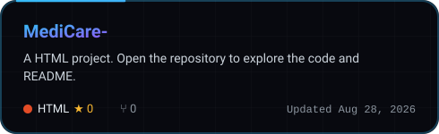</a>

<a href="https://uzairbaig991.github.io/Portfolio/dashboard/" title="Open the live interactive dashboard"></a>

  

<b>🌐 Web Applications</b>

 

| Project | Link |
|---|---|
| 🛒 UzairMart (e-commerce) | [Code](https://github.com/UzairBaig991/UzairMart) |
| 🏥 MediCare | [Code](https://github.com/UzairBaig991/MediCare-) |
| 💊 PharmaCare | [Code](https://github.com/UzairBaig991/pharmacare) |
| 🩺 Prescripto | [Code](https://github.com/UzairBaig991/Prescripto) |
| 🏋️ Gym Website | [Code](https://github.com/UzairBaig991/Gym-Website) |
| 🐾 RecuPaws | [Code](https://github.com/UzairBaig991/RecuPaws) |
| 🤝 Connect Hub | [Code](https://github.com/UzairBaig991/Connect-Hub) |
| ⌨️ Type Forge | [Code](https://github.com/UzairBaig991/Type-Forge) |
| 🏕️ Camping & Outdoor Adventure Planner | [Code](https://github.com/UzairBaig991/Camping-and-Outdoor-Adventure-Planner) |
| 🍳 Recipe Finder | [Code](https://github.com/UzairBaig991/Recipe-Finder) |
| 🕒 Time Zone Converter | [Code](https://github.com/UzairBaig991/Time-Zone-Converter) |
| 💰 Crypto Currency | [Code](https://github.com/UzairBaig991/Crypto-Currency) |
| 🎵 Music Playlist | [Code](https://github.com/UzairBaig991/MUSIC-PLAYLIST) |
| 🗣️ Voice Assistant (lab task) | [Code](https://github.com/UzairBaig991/Web-Programming-LabTask-VoiceAssistant) |
| 🎶 Cadence (lab task) | [Code](https://github.com/UzairBaig991/Web-Programming-lab-Task-Cadence) |

<b>🧩 Syntecxhub Internship Projects</b>

 

| Project | Link |
|---|---|
| 🛍️ E-commerce Store | [Code](https://github.com/UzairBaig991/Syntecxhub-E-commerce-store) |
| ✅ Task Manager | [Code](https://github.com/UzairBaig991/Syntecxhub-Task-Manager) |
| 👥 User Management System | [Code](https://github.com/UzairBaig991/Syntecxhub-User-Management-System) |
| 🌦️ Weather App | [Code](https://github.com/UzairBaig991/Syntecxhub-Weather-App) |
| 💸 Expense Tracker | [Code](https://github.com/UzairBaig991/Syntecxhub-Expense-Tracker) |
| 📝 Notes App | [Code](https://github.com/UzairBaig991/Syntecxhub-Notes-App) |

<b>📱 Mobile & Games</b>

 

| Project | Link |
|---|---|
| 🌱 EcoSwap (MAD project) | [Code](https://github.com/UzairBaig991/EcoSwap-MAD-Project) |
| ❓ Quiz Android App | [Code](https://github.com/UzairBaig991/Quiz-Android-App) |
| 📲 Mobile App Development | [Code](https://github.com/UzairBaig991/Mobile-App-Development) |
| 🎲 RoyalLudo | [Code](https://github.com/UzairBaig991/RoyalLudo) |
| 🎲 LudoVerse | [Code](https://github.com/UzairBaig991/LudoVerse) |
| ✔️ To-Do Apps | [Simple](https://github.com/UzairBaig991/Simple-To-Do-App) · [Classic](https://github.com/UzairBaig991/To-Do-App) |

<b>🎓 Academic & Systems</b>

 

| Project | Link |
|---|---|
| 🤖 Artificial Intelligence Lab | [Code](https://github.com/UzairBaig991/Artificial-Intelligence-Lab) |
| 🖥️ OS Simulator | [Code](https://github.com/UzairBaig991/OS-Simulator) |
| 🔤 Lexical Analyzer | [Code](https://github.com/UzairBaig991/Lexical-Analyzer) |
| 📈 Analysis of Algorithms | [Code](https://github.com/UzairBaig991/AnalysisofAlgorithmSE) |
| 🧮 DSA Final Project (Collaboration) | [Code](https://github.com/UzairBaig991/DSA-Final-Project-Collaboration) |
| 🧮 DSA Lab Tasks | [Code](https://github.com/UzairBaig991/DSALATASKS) |
| ⚙️ CO Lab Tasks | [Code](https://github.com/UzairBaig991/COALLABTASKS) |
| 🧱 Assembly (ASM) Project | [Code](https://github.com/UzairBaig991/ASM-Project) |
| 🎨 HCI & Computer Graphics | [Code](https://github.com/UzairBaig991/HCI-And-ComputerGraphics) |
| 🌐 Web Programming (weekly work) | [Main](https://github.com/UzairBaig991/Web-Programming) · [Wk 6](https://github.com/UzairBaig991/WebProgramming6th-Week) · [Wk 8](https://github.com/UzairBaig991/WebProgramming8th-Week) · [Wk 10](https://github.com/UzairBaig991/WebProgramming10th-Week) |
| 🐘 PHP Practice | [Code](https://github.com/UzairBaig991/PHP-Practice) |
| 📦 All Software Projects | [Code](https://github.com/UzairBaig991/ALLSOFTWAREPROJECTS1) |
| 📁 Early Projects | [Code](https://github.com/UzairBaig991/PROJECTS) |

<!-- Built from your repository history. EDIT any milestone to match your story. -->

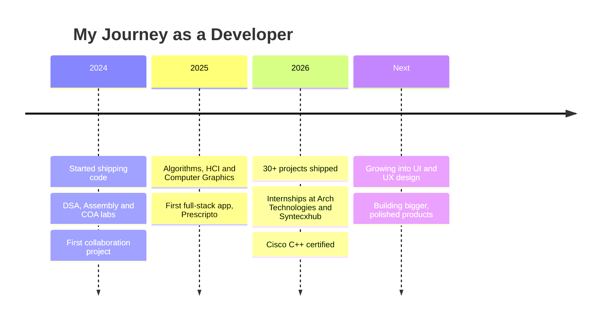

<!-- EDIT: add your exact role titles and dates in place of the "Intern" lines. -->

<table>
<tr>
<td width="50%" valign="top">

### 🏢 Arch Technologies
**Intern** · *add dates here*

Hands-on industry experience working on real software tasks and building practical skills in a professional environment.

</td>
<td width="50%" valign="top">

### 🏢 Syntecxhub
**Intern** · *add dates here*

Delivered a series of real-world projects: <a href="https://github.com/UzairBaig991/Syntecxhub-E-commerce-store">E-commerce Store</a>, <a href="https://github.com/UzairBaig991/Syntecxhub-Task-Manager">Task Manager</a>, <a href="https://github.com/UzairBaig991/Syntecxhub-User-Management-System">User Management System</a>, <a href="https://github.com/UzairBaig991/Syntecxhub-Weather-App">Weather App</a>, <a href="https://github.com/UzairBaig991/Syntecxhub-Expense-Tracker">Expense Tracker</a> and <a href="https://github.com/UzairBaig991/Syntecxhub-Notes-App">Notes App</a>.

</td>
</tr>
</table>

| Certificate | Issuer | Skills |
|:---:|:---:|:---:|
| 🏅 **C++ Certification** | **Cisco** | C++ programming · Problem solving · Object-oriented concepts |

<!-- EDIT: add the full certificate title, year and credential link. -->

- 🏫 **BS Software Engineering**, **Riphah International University**, Rawalpindi *(in progress)*
- 📘 **Coursework:** Data Structures & Algorithms, Operating Systems, Artificial Intelligence, Compiler Construction, Web Programming, Mobile App Development, HCI & Computer Graphics, Computer Organization, Assembly Language

<table>
<tr>
<td align="center" width="25%">🌐 <b>Web Development</b> Responsive websites and full web apps</td>
<td align="center" width="25%">📱 <b>Mobile Apps</b> Android apps from the MAD course and beyond</td>
<td align="center" width="25%">🎨 <b>UI/UX Design</b> Clean, user-friendly interfaces</td>
<td align="center" width="25%">🧠 <b>Problem Solving</b> Algorithms, AI and systems projects</td>
</tr>
</table>

### ⚙️ How I Work

### 🤝 Why Work With Me

- ✅ **I ship real projects.** 50+ repositories across web, mobile, AI and systems
- ✅ **Industry-tested.** Internship experience at Arch Technologies and Syntecxhub
- ✅ **Strong fundamentals.** Cisco C++ certified, with a solid DSA, OS and compiler background
- ✅ **Design-minded.** I care about how software looks and feels, not just how it runs
- ✅ **Always learning.** Actively growing toward a UI/UX career

> 🖱️ **Click any graph to open my [live interactive dashboard](https://uzairbaig991.github.io/Portfolio/dashboard/)**, with hover tooltips, a real-time activity feed and a searchable repo explorer.

### ⚡ Recently Updated

<!-- Auto-updated every 3 hours by .github/workflows/update-stats.yml. Do not edit between the markers. -->
<!-- RECENT:START -->
| Repository | Language | Last push |
|---|---|---|
| [**Portfolio**](https://github.com/UzairBaig991/Portfolio) | HTML | Nov 25, 2026 |
| [**EcoSwap-MAD-Project**](https://github.com/UzairBaig991/EcoSwap-MAD-Project) | Dart | Nov 24, 2026 |
| [**RoyalLudo**](https://github.com/UzairBaig991/RoyalLudo) | TypeScript | Nov 24, 2026 |
| [**Artificial-Intelligence-Lab**](https://github.com/UzairBaig991/Artificial-Intelligence-Lab) | Python | Nov 18, 2026 |
| [**Lexical-Analyzer**](https://github.com/UzairBaig991/Lexical-Analyzer) | C++ | Nov 18, 2026 |
| [**OS-Simulator**](https://github.com/UzairBaig991/OS-Simulator) | JavaScript | Nov 18, 2026 |

⏱ Auto-updated Nov 25, 2026 10:22 UTC
<!-- RECENT:END -->

### 📈 Contribution Analytics

 

<!-- Self-hosted graphics below are refreshed daily by .github/workflows/update-stats.yml -->
<a href="https://uzairbaig991.github.io/Portfolio/dashboard/" title="Open the live interactive dashboard"></a>

  

<a href="https://uzairbaig991.github.io/Portfolio/dashboard/" title="Open the live interactive dashboard"></a>

  

 

 

- [x] Build 50+ projects across web, mobile, AI and systems
- [x] Launch a personal portfolio website
- [x] Complete internships at Arch Technologies and Syntecxhub
- [x] Earn the Cisco C++ certification
- [ ] Grow into a professional UI/UX Designer
- [ ] Contribute to open-source projects
- [ ] Land a software or design role

I'm open to **internships, collaborations and freelance work**. If you have an idea or a team that needs a motivated developer-designer, let's talk!

 

 

> 💡 *"Design is not just what it looks like. Design is how it works."* — Steve Jobs

⭐ **If you like my work, consider starring my repositories!** ⭐

