<!-- Profile README for github.com/UzairBaig991
     Search for "EDIT:" to find details you can still personalize. -->

<!-- ===== BANNER ===== -->

 

 

<a href="#about"><b>🏠 About</b></a> &nbsp;·&nbsp;
<a href="#tech"><b>⚡ Skills</b></a> &nbsp;·&nbsp;
<a href="#projects"><b>🚀 Projects</b></a> &nbsp;·&nbsp;
<a href="#more"><b>🗂️ More Work</b></a> &nbsp;·&nbsp;
<a href="#journey"><b>🛣️ Journey</b></a> &nbsp;·&nbsp;
<a href="#experience"><b>💼 Experience</b></a> &nbsp;·&nbsp;
<a href="#certificates"><b>📜 Certificates</b></a> &nbsp;·&nbsp;
<a href="#education"><b>🎓 Education</b></a> &nbsp;·&nbsp;
<a href="#lab"><b>🧬 Lab</b></a> &nbsp;·&nbsp;
<a href="#contact"><b>📫 Contact</b></a>

> *"I turn ideas into clean, working software, and I'm growing into a designer who cares how it feels to use."*

Hi, I'm **Uzair Baig** from **Rawalpindi, Pakistan 🇵🇰**, a **BS Software Engineering** student at **Riphah International University** (Rawalpindi) with hands-on experience from **two internships** and a **Cisco C++ certification**. I build web apps, mobile apps, AI tools and system simulators, and my goal is to become a **UI/UX Designer** who can also write the code behind the design.

| 🎓 Studying | 💼 Internships | 📜 Certified | 📦 Projects | 🎯 Goal |
|:---:|:---:|:---:|:---:|:---:|
| **BS Software Engineering** | **2** (Arch Technologies, Syntecxhub) | **Cisco C++** | **50+ repos** | **UI/UX Designer** |

<table>
<tr>
<td>

| | |
|---|---|
| 🔭 **Currently working on** | <!-- LATEST:START -->[EcoSwap-MAD-Project](https://github.com/UzairBaig991/EcoSwap-MAD-Project) · [Prescripto](https://github.com/UzairBaig991/Prescripto) · [RoyalLudo](https://github.com/UzairBaig991/RoyalLudo) · [Smart-Clinic-Management-System](https://github.com/UzairBaig991/Smart-Clinic-Management-System)<!-- LATEST:END --> |
| 🌱 **Learning** | UI/UX design, Figma, advanced web & mobile development |
| 🤝 **Open to** | Internships, collaborations, freelance projects |
| 💬 **Ask me about** | Web development, Android apps, C++, DSA, UI design |
| 📍 **Based in** | Rawalpindi, Pakistan (UTC+5) |
| ⚡ **Fun fact** | I've built everything from a Ludo game to an OS simulator |

</td>
</tr>
</table>


<!-- Remove any icon for tools you don't actually use. -->


**Languages** 

**Web & Mobile** 

**Backend & Databases** 

**Design & Tools** 

### 🧠 Core Computer Science

### 🗺️ Skills Map

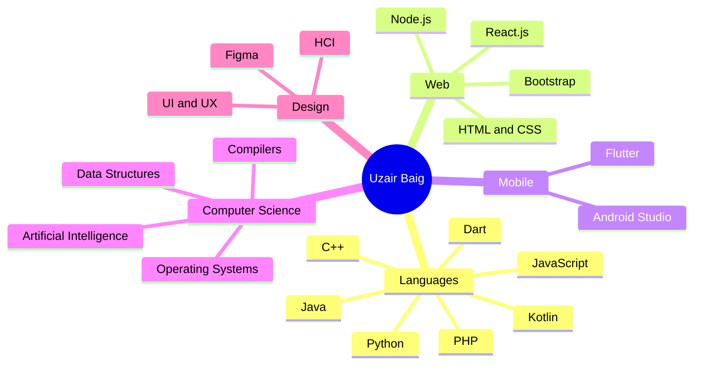

<a href="https://github.com/UzairBaig991/StockWise-AI">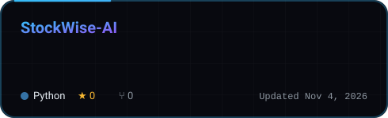</a>

<a href="https://github.com/UzairBaig991/RoyalLudo">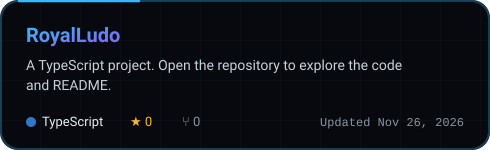</a>

<a href="https://github.com/UzairBaig991/UzairMart">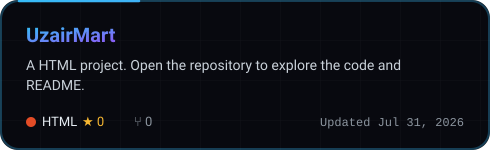</a>

  

<a href="https://uzairbaig991.github.io/Portfolio/dashboard/" title="Open the live interactive dashboard"></a>

<!-- Auto-generated from my live repositories every 30 minutes. Do not edit between the markers. -->
<!-- PROJECTS:START -->

<b>🌐 Web Applications (14)</b>

 

| Project | Language | Updated | Link |
|---|---|---|---|
| **Prescripto** | JavaScript | Nov 26, 2026 | [Code](https://github.com/UzairBaig991/Prescripto) |
| **Smart Clinic Management System** | JavaScript | Nov 25, 2026 | [Code](https://github.com/UzairBaig991/Smart-Clinic-Management-System) |
| **Web Programming LabTask VoiceAssistant** | JavaScript | Sep 24, 2026 | [Code](https://github.com/UzairBaig991/Web-Programming-LabTask-VoiceAssistant) |
| **Web Programming lab Task Cadence** | HTML | Sep 24, 2026 | [Code](https://github.com/UzairBaig991/Web-Programming-lab-Task-Cadence) |
| **Type Forge** | JavaScript | Sep 24, 2026 | [Code](https://github.com/UzairBaig991/Type-Forge) |
| **MediCare** | HTML | Aug 28, 2026 | [Code](https://github.com/UzairBaig991/MediCare-) |
| **Camping and Outdoor Adventure Planner** | JavaScript | Aug 19, 2026 | [Code](https://github.com/UzairBaig991/Camping-and-Outdoor-Adventure-Planner) |
| **UzairMart** | HTML | Jul 31, 2026 | [Code](https://github.com/UzairBaig991/UzairMart) |
| **Time Zone Converter** | JavaScript | Jun 10, 2026 | [Code](https://github.com/UzairBaig991/Time-Zone-Converter) |
| **RecuPaws** It is the Simple animal charity website for donations of animals. | HTML | Jun 9, 2026 | [Code](https://github.com/UzairBaig991/RecuPaws) |
| **Gym Website** This is my Simple Gym Website. | HTML | Jun 9, 2026 | [Code](https://github.com/UzairBaig991/Gym-Website) |
| **pharmacare** | JavaScript | May 4, 2026 | [Code](https://github.com/UzairBaig991/pharmacare) |
| **Connect Hub** Simple Social Media Platform in which user can sent friend request to the users, posts the images and other things, like and dislike the posts and also comment on this. | JavaScript | Apr 6, 2026 | [Code](https://github.com/UzairBaig991/Connect-Hub) |
| **MUSIC PLAYLIST** Uzair’s Music Player is a complete, professional-grade web application that successfully meets and exceeds the initial requirements.  | HTML | Apr 4, 2026 | [Code](https://github.com/UzairBaig991/MUSIC-PLAYLIST) |

<b>🎓 Academic & Systems (16)</b>

 

| Project | Language | Updated | Link |
|---|---|---|---|
| **Artificial Intelligence Lab** In this repository, i have uploaded my AI lab tasks in which i can create the simple programs using python and other languages. | Python | Nov 18, 2026 | [Code](https://github.com/UzairBaig991/Artificial-Intelligence-Lab) |
| **Lexical Analyzer** | C++ | Nov 18, 2026 | [Code](https://github.com/UzairBaig991/Lexical-Analyzer) |
| **OS Simulator** | JavaScript | Nov 18, 2026 | [Code](https://github.com/UzairBaig991/OS-Simulator) |
| **WebProgramming10th Week** | PHP | Oct 29, 2026 | [Code](https://github.com/UzairBaig991/WebProgramming10th-Week) |
| **WebProgramming8th Week** | PHP | Oct 29, 2026 | [Code](https://github.com/UzairBaig991/WebProgramming8th-Week) |
| **WebProgramming6th Week** | PHP | Oct 29, 2026 | [Code](https://github.com/UzairBaig991/WebProgramming6th-Week) |
| **PHP Practice** | PHP | Oct 18, 2026 | [Code](https://github.com/UzairBaig991/PHP-Practice) |
| **Web Programming** | HTML | Oct 14, 2026 | [Code](https://github.com/UzairBaig991/Web-Programming) |
| **AnalysisofAlgorithmSE** | HTML | May 31, 2025 | [Code](https://github.com/UzairBaig991/AnalysisofAlgorithmSE) |
| **ALLSOFTWAREPROJECTS1** | Python | May 31, 2025 | [Code](https://github.com/UzairBaig991/ALLSOFTWAREPROJECTS1) |
| **HCI And ComputerGraphics** | HTML | May 4, 2025 | [Code](https://github.com/UzairBaig991/HCI-And-ComputerGraphics) |
| **ASM Project** | Assembly | Dec 6, 2024 | [Code](https://github.com/UzairBaig991/ASM-Project) |
| **DSA Final Project Collaboration** | C++ | Nov 22, 2024 | [Code](https://github.com/UzairBaig991/DSA-Final-Project-Collaboration) |
| **COALLABTASKS** | Assembly | Nov 20, 2024 | [Code](https://github.com/UzairBaig991/COALLABTASKS) |
| **DSALATASKS** | C++ | Nov 5, 2024 | [Code](https://github.com/UzairBaig991/DSALATASKS) |
| **PROJECTS** | C++ | Oct 30, 2024 | [Code](https://github.com/UzairBaig991/PROJECTS) |

<b>📱 Mobile & Games (9)</b>

 

| Project | Language | Updated | Link |
|---|---|---|---|
| **EcoSwap MAD Project** | Dart | Nov 26, 2026 | [Code](https://github.com/UzairBaig991/EcoSwap-MAD-Project) |
| **RoyalLudo** | TypeScript | Nov 26, 2026 | [Code](https://github.com/UzairBaig991/RoyalLudo) |
| **LudoVerse** | TypeScript | Nov 13, 2026 | [Code](https://github.com/UzairBaig991/LudoVerse) |
| **Mobile App Development** | Dart | Nov 13, 2026 | [Code](https://github.com/UzairBaig991/Mobile-App-Development) |
| **Quiz Android App** | Kotlin | Aug 18, 2026 | [Code](https://github.com/UzairBaig991/Quiz-Android-App) |
| **Crypto Currency** | Kotlin | Aug 9, 2026 | [Code](https://github.com/UzairBaig991/Crypto-Currency) |
| **Recipe Finder** | Dart | Jul 3, 2026 | [Code](https://github.com/UzairBaig991/Recipe-Finder) |
| **Simple To Do App** | HTML | Mar 24, 2026 | [Code](https://github.com/UzairBaig991/Simple-To-Do-App) |
| **To Do App** A modern, user-friendly to-do list application built with HTML, CSS, and JavaScript for the frontend, and Node.js with Express for a simple backend. Tasks are persistently stored in a JSON file, allowing data to survive page refreshes without a full database. | JavaScript | Mar 9, 2026 | [Code](https://github.com/UzairBaig991/To-Do-App) |

<b>🧩 Syntecxhub Projects (6)</b>

 

| Project | Language | Updated | Link |
|---|---|---|---|
| **Notes App** This is the simple notes app in which the user can delete, add and edit notes. | JavaScript | Jul 2, 2026 | [Code](https://github.com/UzairBaig991/Syntecxhub-Notes-App) |
| **E commerce store** | JavaScript | May 12, 2026 | [Code](https://github.com/UzairBaig991/Syntecxhub-E-commerce-store) |
| **Task Manager** | JavaScript | May 2, 2026 | [Code](https://github.com/UzairBaig991/Syntecxhub-Task-Manager) |
| **User Management System** "A modern, full-stack User Management System featuring a secure admin dashboard, real-time user statistics, and comprehensive CRUD operations for managing active and inactive accounts." | JavaScript | Apr 21, 2026 | [Code](https://github.com/UzairBaig991/Syntecxhub-User-Management-System) |
| **Weather App** This is my simple weather app whuch gives the forecasting of about 5 dayds. | JavaScript | Apr 13, 2026 | [Code](https://github.com/UzairBaig991/Syntecxhub-Weather-App) |
| **Expense Tracker** This is the simple Expense Tracker app for my internship project which is about to manage all the expenses and other important things. | HTML | Apr 13, 2026 | [Code](https://github.com/UzairBaig991/Syntecxhub-Expense-Tracker) |

<b>🛠️ AI, ERP & Tools (5)</b>

 

| Project | Language | Updated | Link |
|---|---|---|---|
| **PDFForge** | PHP | Nov 12, 2026 | [Code](https://github.com/UzairBaig991/PDFForge) |
| **StockWise AI** | Python | Nov 4, 2026 | [Code](https://github.com/UzairBaig991/StockWise-AI) |
| **AutoFlow** | TypeScript | Nov 2, 2026 | [Code](https://github.com/UzairBaig991/AutoFlow) |
| **Enterprise Flow ERP** | TypeScript | Sep 2, 2026 | [Code](https://github.com/UzairBaig991/Enterprise-Flow-ERP) |
| **Movie Recommendation System** | JavaScript | Aug 15, 2026 | [Code](https://github.com/UzairBaig991/Movie-Recommendation-System) |

<b>🖥️ Portfolio Sites (3)</b>

 

| Project | Language | Updated | Link |
|---|---|---|---|
| **Portfolio** This is my personal portfolio website in which I can talk about my all the journey from school level to university level. | HTML | Nov 25, 2026 | [Code](https://github.com/UzairBaig991/Portfolio) |
| **Portfolio Updated** | – | Jul 2, 2026 | [Code](https://github.com/UzairBaig991/Portfolio-Updated) |
| **UzairBaig.github.io** | CSS | Jan 18, 2025 | [Code](https://github.com/UzairBaig991/UzairBaig.github.io) |

<!-- PROJECTS:END -->

<!-- Built from your repository history. EDIT any milestone to match your story. -->

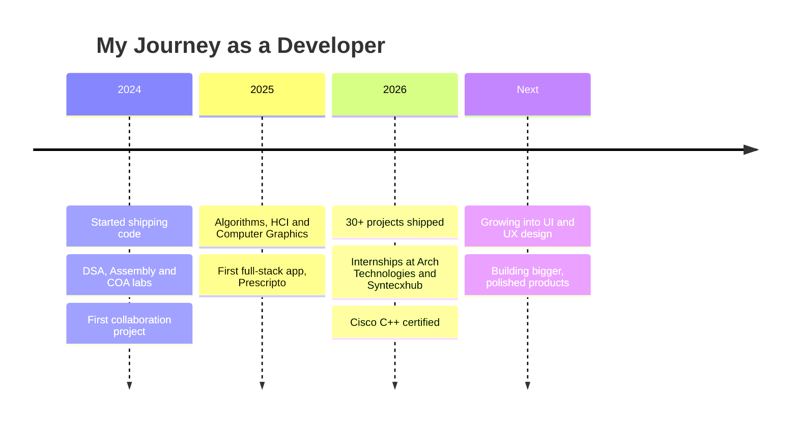

<!-- EDIT: add your exact role titles and dates in place of the "Intern" lines. -->

<table>
<tr>
<td width="50%" valign="top">

### 🏢 Arch Technologies
**Intern** · *add dates here*

Hands-on industry experience working on real software tasks and building practical skills in a professional environment.

</td>
<td width="50%" valign="top">

### 🏢 Syntecxhub
**Intern** · *add dates here*

Delivered a series of real-world projects: <a href="https://github.com/UzairBaig991/Syntecxhub-E-commerce-store">E-commerce Store</a>, <a href="https://github.com/UzairBaig991/Syntecxhub-Task-Manager">Task Manager</a>, <a href="https://github.com/UzairBaig991/Syntecxhub-User-Management-System">User Management System</a>, <a href="https://github.com/UzairBaig991/Syntecxhub-Weather-App">Weather App</a>, <a href="https://github.com/UzairBaig991/Syntecxhub-Expense-Tracker">Expense Tracker</a> and <a href="https://github.com/UzairBaig991/Syntecxhub-Notes-App">Notes App</a>.

</td>
</tr>
</table>

| Certificate | Issuer | Skills |
|:---:|:---:|:---:|
| 🏅 **C++ Certification** | **Cisco** | C++ programming · Problem solving · Object-oriented concepts |

<!-- EDIT: add the full certificate title, year and credential link. -->

- 🏫 **BS Software Engineering**, **Riphah International University**, Rawalpindi *(in progress)*
- 📘 **Coursework:** Data Structures & Algorithms, Operating Systems, Artificial Intelligence, Compiler Construction, Web Programming, Mobile App Development, HCI & Computer Graphics, Computer Organization, Assembly Language

<table>
<tr>
<td align="center" width="25%">🌐 <b>Web Development</b> Responsive websites and full web apps</td>
<td align="center" width="25%">📱 <b>Mobile Apps</b> Android apps from the MAD course and beyond</td>
<td align="center" width="25%">🎨 <b>UI/UX Design</b> Clean, user-friendly interfaces</td>
<td align="center" width="25%">🧠 <b>Problem Solving</b> Algorithms, AI and systems projects</td>
</tr>
</table>

### ⚙️ How I Work

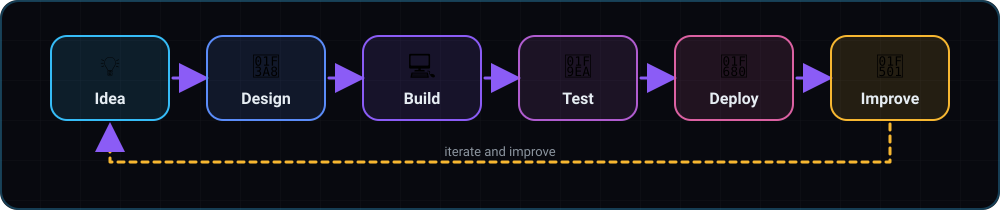

### 🤝 Why Work With Me

- ✅ **I ship real projects.** 50+ repositories across web, mobile, AI and systems
- ✅ **Industry-tested.** Internship experience at Arch Technologies and Syntecxhub
- ✅ **Strong fundamentals.** Cisco C++ certified, with a solid DSA, OS and compiler background
- ✅ **Design-minded.** I care about how software looks and feels, not just how it runs
- ✅ **Always learning.** Actively growing toward a UI/UX career

<a href="https://github.com/UzairBaig991?tab=repositories">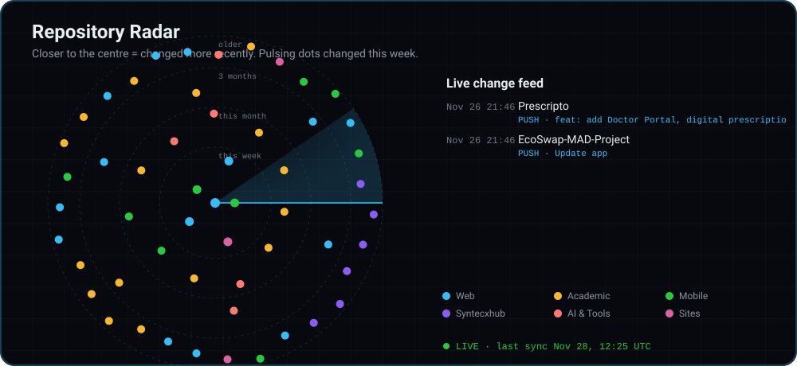</a>

### 🛰️ Change Log

> Every refresh compares all my repositories with the previous snapshot. New repos, pushes, stars and forks show up below with the commit message. The workflow checks every 10 minutes.

<!-- CHANGES:START -->
| | Repository | What changed | Detected (UTC) |
|---|---|---|---|
| 🚀 | [**Prescripto**](https://github.com/UzairBaig991/Prescripto) | feat: add Doctor Portal, digital prescriptions, reviews, rescheduling, search &  | Nov 26, 21:46 |
| 🚀 | [**EcoSwap-MAD-Project**](https://github.com/UzairBaig991/EcoSwap-MAD-Project) | Update app | Nov 26, 21:46 |
<!-- CHANGES:END -->

Everything in this lab is generated from my real GitHub data and refreshed automatically.

  


  

  

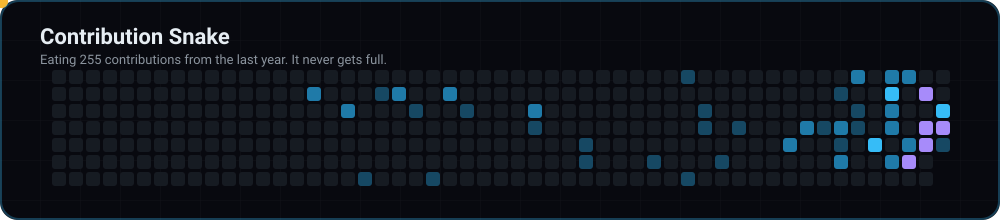

  

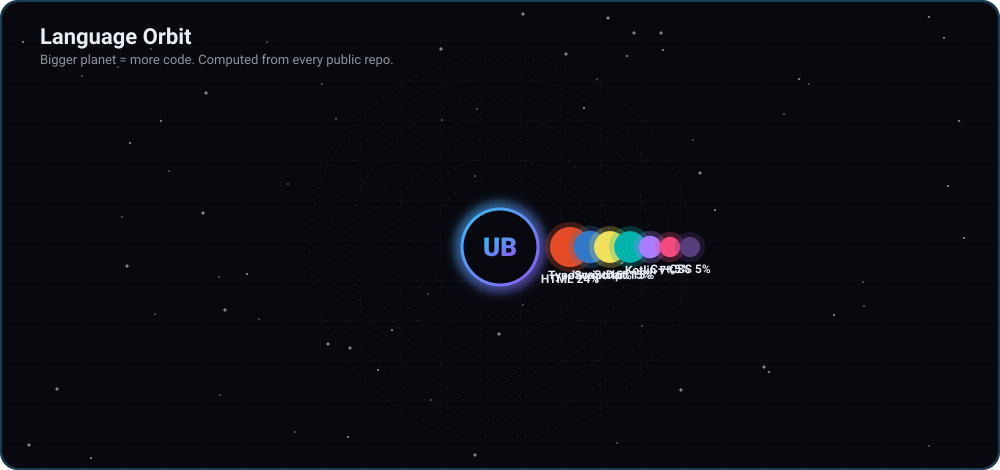

  


> 🖱️ **Click any graph to open my [live interactive dashboard](https://uzairbaig991.github.io/Portfolio/dashboard/)**, with hover tooltips, a real-time activity feed and a searchable repo explorer.

### ⚡ Recently Updated

<!-- Auto-updated every 30 minutes by .github/workflows/update-stats.yml. Do not edit between the markers. -->
<!-- RECENT:START -->
| Repository | Latest change | Language | When |
|---|---|---|---|
| [**EcoSwap-MAD-Project**](https://github.com/UzairBaig991/EcoSwap-MAD-Project) | Update app | Dart | Nov 26, 2026 |
| [**Prescripto**](https://github.com/UzairBaig991/Prescripto) | feat: add Doctor Portal, digital prescriptions, reviews, rescheduling, | JavaScript | Nov 26, 2026 |
| [**RoyalLudo**](https://github.com/UzairBaig991/RoyalLudo) | Unify Expo Go mobile app with live Desktop/Server Royal Ludo game via  | TypeScript | Nov 26, 2026 |
| [**Smart-Clinic-Management-System**](https://github.com/UzairBaig991/Smart-Clinic-Management-System) | feat: add Ctrl+K command palette, inline edit/reschedule modals, CSV e | JavaScript | Nov 25, 2026 |
| [**Portfolio**](https://github.com/UzairBaig991/Portfolio) | Add live interactive GitHub dashboard | HTML | Nov 25, 2026 |
| [**Artificial-Intelligence-Lab**](https://github.com/UzairBaig991/Artificial-Intelligence-Lab) | Tenth Lab Linear Regression | Python | Nov 18, 2026 |

⏱ Auto-updated Nov 28, 2026 12:26 UTC, follows my latest pushes
<!-- RECENT:END -->

### 📈 Contribution Analytics


 

<!-- Self-hosted graphics below are refreshed daily by .github/workflows/update-stats.yml -->

  

  

<a href="https://uzairbaig991.github.io/Portfolio/dashboard/" title="Open the live interactive dashboard"></a>

 

 

- [x] Build 50+ projects across web, mobile, AI and systems
- [x] Launch a personal portfolio website
- [x] Complete internships at Arch Technologies and Syntecxhub
- [x] Earn the Cisco C++ certification
- [ ] Grow into a professional UI/UX Designer
- [ ] Contribute to open-source projects
- [ ] Land a software or design role

I'm open to **internships, collaborations and freelance work**. If you have an idea or a team that needs a motivated developer-designer, let's talk!

 

 

> 💡 *"Design is not just what it looks like. Design is how it works."* — Steve Jobs

⭐ **If you like my work, consider starring my repositories!** ⭐

